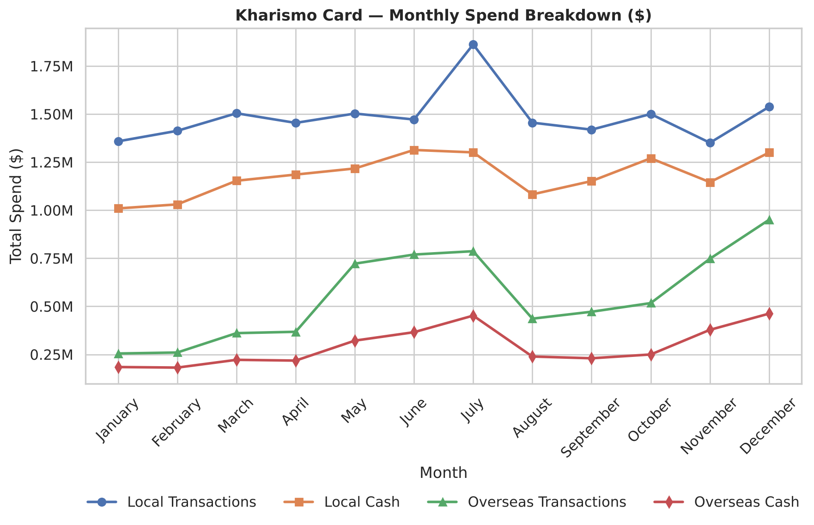
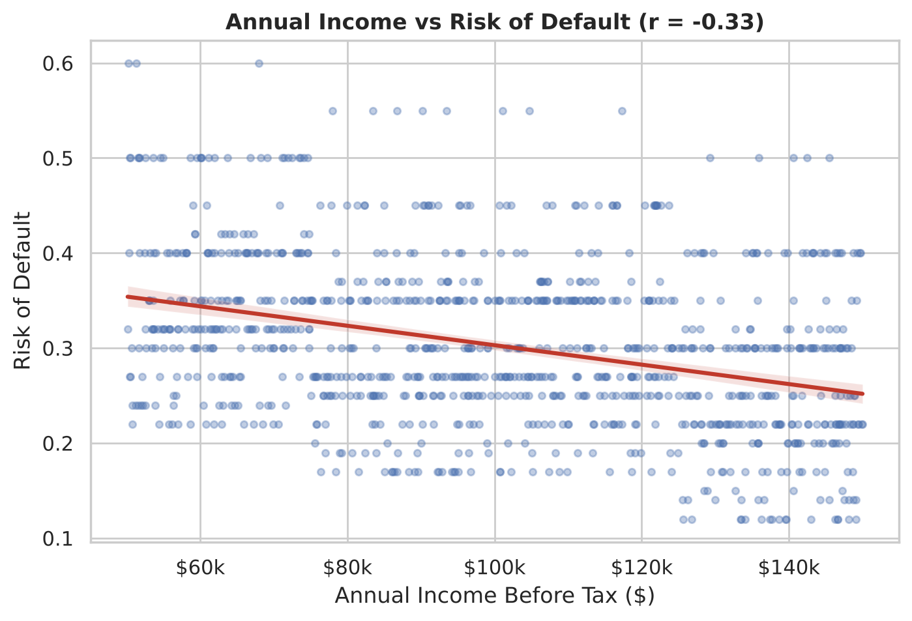
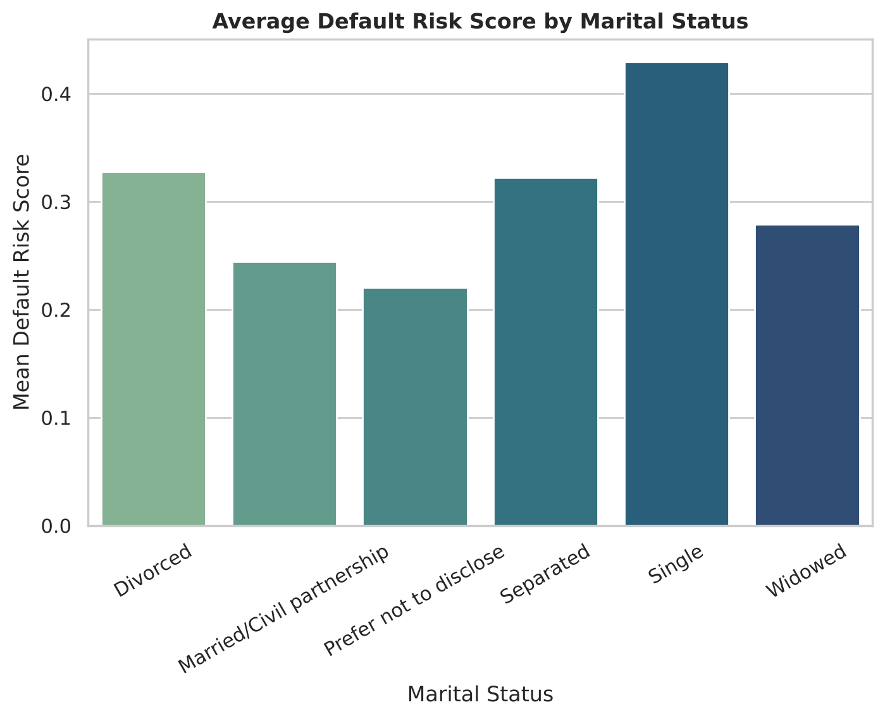
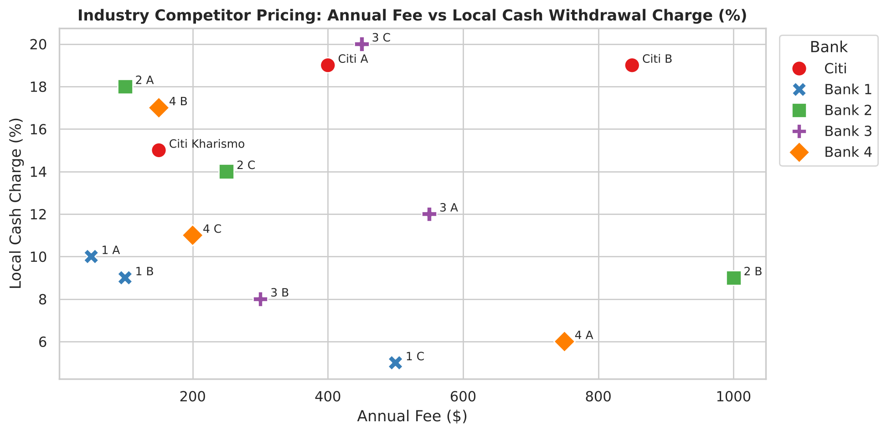
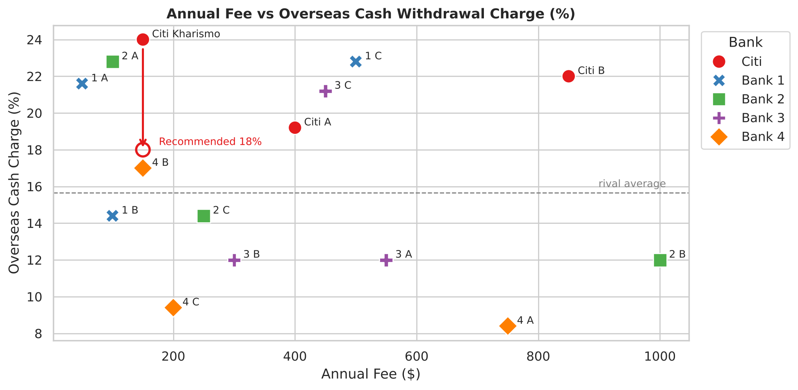

# U.S. Consumer Cards Job Simulation — Citi × Forage

*August 2026*

Designing a new credit card, **Citi Kharismo**, and then analysing its first 12 months: who the 1,000 cardholders are, how they spend, what drives their risk of default, and how the card's fees compare with 4 rival banks.

The project has two parts:

1. **Proposition design.** A launch strategy for Kharismo: target segment, features, launch offer and roadmap ([deck](decks/Citi_Kharismo_Launch_Strategy.pdf)).
2. **Portfolio analytics.** A 12-month review of the live portfolio with statistical testing and pricing benchmarks, turned into recommendations for leadership ([deck](decks/Citi_Kharismo_12_Month_Insights.pdf)). Everything in this part is reproduced by the Python scripts in this repo.

> **Data note:** the data is synthetic and was provided by Citi through the Forage job simulation. Kharismo is a fictional product, and no real customer data is used.

---

## Headline results

| | |
|---|---|
| Active cardholders | **1,000** |
| Total 12-month spend | **$42.13M** ($42.1k per cardholder) |
| Income vs risk of default | **r = −0.33** (p < 0.001) |
| Age vs risk of default | **r = −0.07** (explains under 1% of variance) |
| Marital status vs risk (ANOVA) | **F = 263, p < 0.001, η² = 0.57** |
| Kharismo overseas cash charge | **24.0%**, the highest of 15 cards; **recommended cut to 18.0%** |

Full printed output: [`results/analysis_output.txt`](results/analysis_output.txt)

---

## 1. Portfolio overview — [`scripts/01_portfolio_summary.py`](scripts/01_portfolio_summary.py)

| Channel | 12-month spend | Share |
|---|---|---|
| Local transactions | $17.83M | 42.3% |
| Local cash withdrawals | $14.16M | 33.6% |
| Overseas transactions | $6.64M | 15.8% |
| Overseas cash withdrawals | $3.50M | 8.3% |
| **Total** | **$42.13M** | |

- Mean risk of default is **0.302**, and total default exposure is **$2.45M**.
- **Older base:** 70.1% of cardholders are over 45, and 38.7% are over 65.
- **High income:** 50.4% earn $100k–$150k.
- **Cash heavy:** local cash withdrawals ($14.2M) are almost as large as local card purchases ($17.8M). That gives an opening to move cash users onto card purchases.

## 2. Spend seasonality across 12 months — [`scripts/02_spend_seasonality.py`](scripts/02_spend_seasonality.py)



- Spend peaks in **July ($4.40M)** and **December ($4.25M)**; the low point is **January ($2.81M)**.
- Overseas transactions swing **3.7×** across the year, from $0.25M in January to $0.95M in December. That's a clear travel-season pattern (May–July and November–December).
- **Recommendation:** run double-points promotions in the summer and holiday travel windows.

## 3. What drives risk of default? — [`scripts/03_default_risk.py`](scripts/03_default_risk.py)

**Pearson correlation** for the numeric drivers:

| Driver | r | r² | p-value | Reading |
|---|---|---|---|---|
| Annual income | −0.33 | 0.111 | 1.9 × 10⁻²⁷ | Higher income → lower risk |
| Age | −0.07 | 0.005 | 0.019 | Statistically detectable, but practically negligible |



Mean risk falls from **0.351** ($50k–75k) to **0.299** ($75k–100k) to **0.280** ($100k–150k).

**One-way ANOVA** for the categorical drivers. Does mean risk differ between groups?

| Attribute | F | p-value | η² (share of variance explained) | Result |
|---|---|---|---|---|
| Marital status | 263.44 | < 0.001 | 0.570 | Strong effect |
| Employment status | 1.13 | 0.34 | 0.007 | No significant effect |
| Gender | 3.04 | 0.048 | 0.006 | Borderline, negligible effect |



Single cardholders have the highest mean risk (**0.43**), and married cardholders are among the lowest (**0.24**). A Tukey HSD post-hoc test finds that 14 of the 15 pairs of marital-status groups differ significantly. Only divorced vs separated does not.

### Fair-lending note

Marital status, sex and age are protected characteristics under the U.S. **Equal Credit Opportunity Act (Regulation B)**. They cannot be used to set credit limits or approve applications. (Age is allowed only within a statistically validated credit-scoring system.) So the marital-status result is a **descriptive** finding about this portfolio, not an underwriting rule. The risk actions this analysis supports are:

- **Use income and payment behaviour.** Income is a legitimate driver (r = −0.33), and so is each customer's monthly repayment rate.
- **Monitor credit utilisation.** Send early-warning alerts to cardholders using more than 80% of their limit.
- **Investigate *why* the gap exists.** The marital-status differences may reflect underlying factors such as household income or debt load, which can be used directly.

## 4. Competitor pricing benchmark — [`scripts/04_competitor_pricing.py`](scripts/04_competitor_pricing.py)

Kharismo is compared with Citi's two other cards and **12 cards from 4 rival banks** on annual fee, local cash charge and overseas cash charge.



| Bank (average of 3 cards) | Annual fee | Local cash | Overseas cash |
|---|---|---|---|
| Citi | $467 | 17.7% | 21.7% |
| Bank 1 | $217 | 8.0% | 19.6% |
| Bank 2 | $450 | 13.7% | 16.4% |
| Bank 3 | $433 | 13.3% | 15.1% |
| Bank 4 | $367 | 11.3% | 11.6% |



**Kharismo's overseas cash charge of 24.0% is the highest of all 15 cards**, well above the rival average (15.7%) and median (14.4%).

**Recommendation: cut it to 18.0%.** That moves Kharismo from the most expensive card to **7th of 15** (mid-market). It also keeps the charge below Citi's premium cards A (19.2%) and B (22.0%), so the product line still makes sense. Going all the way to the rival average would give up more fee revenue than the competitive gap requires.

---

## Recommendations to leadership

| Quarter | Action | Evidence |
|---|---|---|
| Q1 | Cut the overseas cash charge from 24% to 18% | Section 4 |
| Q2 | Refine risk management around income, repayment behaviour and utilisation | Section 3 |
| Q3 | Run double-points travel promotions in July and December | Section 2 |
| Q4 | Grow digital acquisition among younger affluent customers (ages 25–40) | Section 1: 70% of the base is over 45 |

---

## Repo structure

```
├── data/
│   ├── customers.csv            # 1,000 cardholders: profile, risk, 12 months x 4 spend channels
│   └── industry_pricing.csv     # 15 cards: Citi (3) + 4 rival banks (12)
├── scripts/
│   ├── extract_data.py          # Excel workbook -> CSVs
│   ├── common.py                # shared loading and chart helpers
│   ├── 01_portfolio_summary.py  # KPIs and demographics
│   ├── 02_spend_seasonality.py  # monthly spend by channel
│   ├── 03_default_risk.py       # Pearson, ANOVA, Tukey HSD
│   └── 04_competitor_pricing.py # fee benchmarking and the 18% recommendation
├── figures/                     # charts produced by the scripts
├── results/analysis_output.txt  # full printed output of run_all.py
├── decks/                       # launch strategy and 12-month insights (PDF)
└── run_all.py                   # runs every step
```

## How to run

```bash
pip install -r requirements.txt
python run_all.py
```

This regenerates every figure and `results/analysis_output.txt` from the CSVs in `data/`.

The CSVs were extracted from the simulation's Excel workbook with `python scripts/extract_data.py <workbook.xlsx>`. The workbook itself is not included.

The market-research figures in the launch-strategy deck (survey of 500 loyal cardholders) come from an earlier simulation task, and that data is not in this repo.
